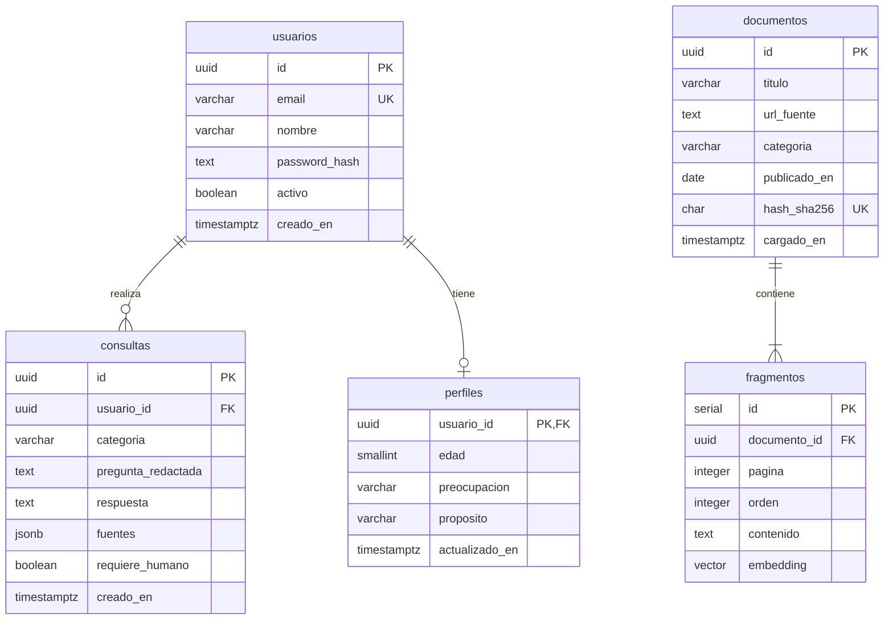

# Modelo de datos

Fuente: `db/init_script.sql`. Para exportar el diagrama a `db/schema_diagram.png`, pegue el bloque en https://mermaid.live y descargue la imagen.

`fragmentos.embedding` es `vector(768)` con índice HNSW de distancia coseno. Las tablas `documentos` y `fragmentos` guardan normativa pública; no contienen datos personales.

`perfiles` guarda los datos del onboarding aparte de las credenciales, en relación uno a uno con `usuarios`. Al borrar un usuario se borra su perfil (`ON DELETE CASCADE`). La edad mínima es 14 porque la Ley 21.719 exige consentimiento de los padres para menores de esa edad, y la app no lo gestiona.

## Migraciones

Las bases nuevas se crean con `db/init_script.sql`, que ya incluye todas las tablas. Las bases existentes se actualizan aplicando en orden los archivos de `db/migrations/`:

| Archivo | Cambio |
|---|---|
| `002_perfiles.sql` | Crea la tabla `perfiles`. Se puede ejecutar más de una vez. |
